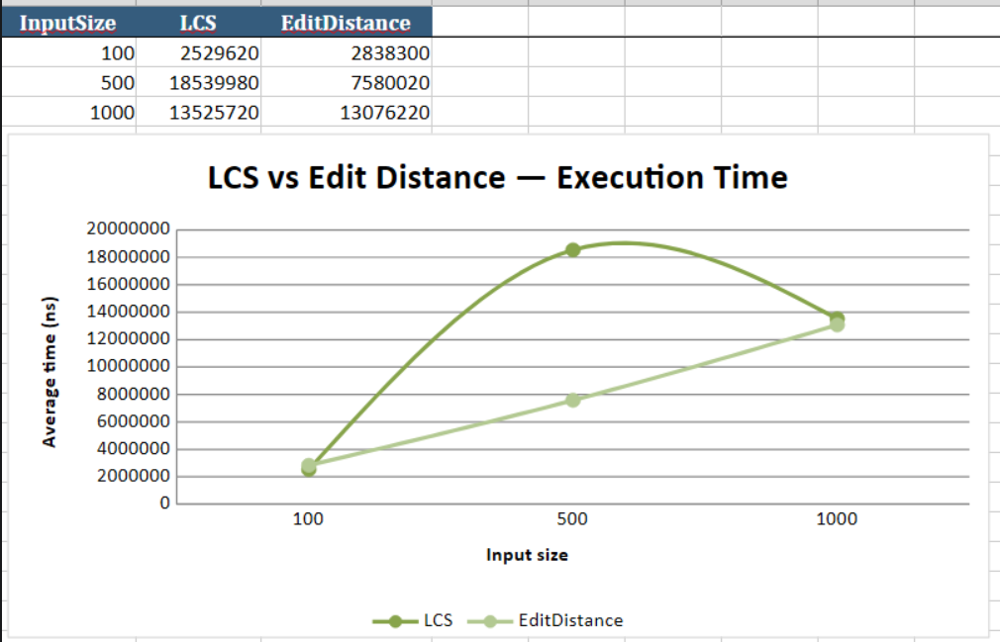
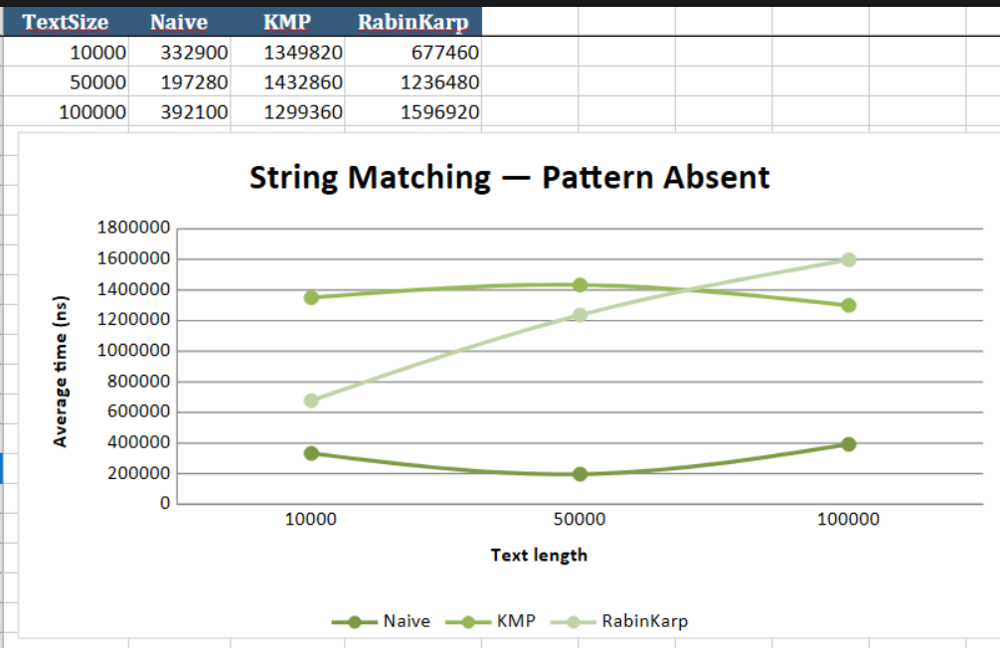
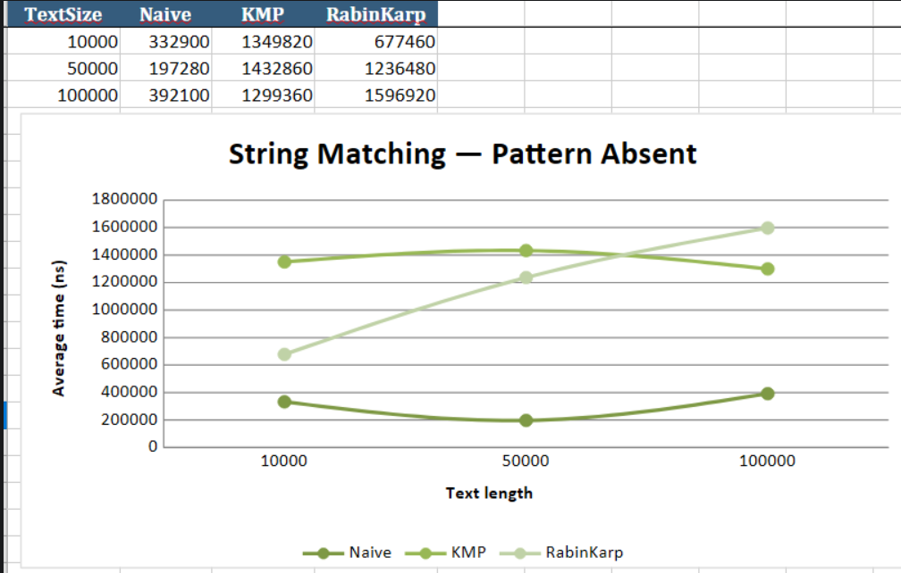
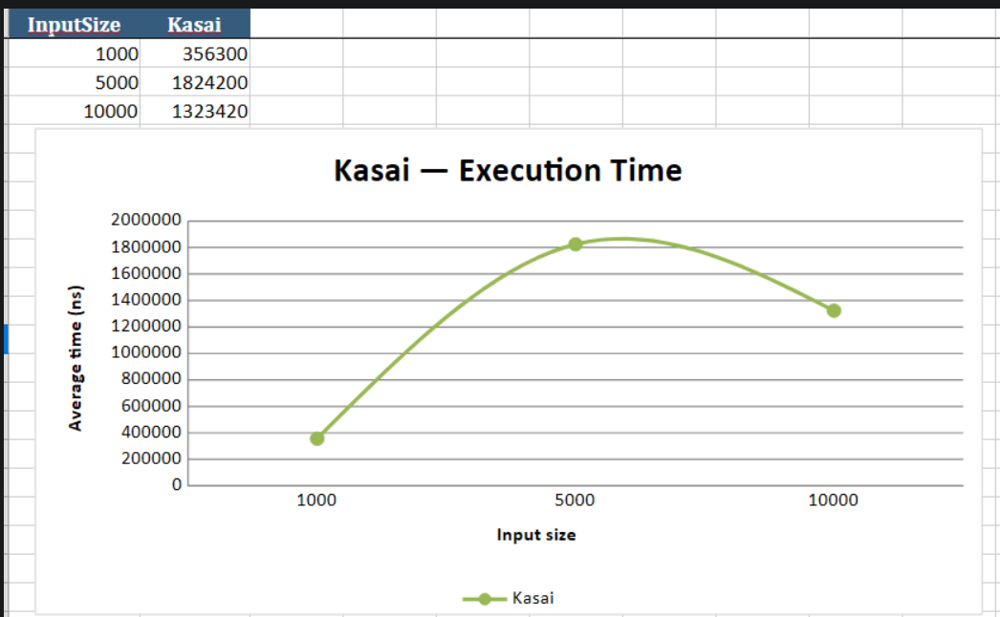

# DAA4
#Samonov Iaroslav, SE-2530

# STRING ALGORITHMS AND DYNAMIC PROGRAMMING

## 1. PROJECT OVERVIEW

This project contains six algorithms for working with strings. It covers Dynamic Programming, String Matching, and Suffix Arrays.

The project also includes tests and performance experiments to compare the algorithms.

## 2. ALGORITHMS

### PART A - DYNAMIC PROGRAMMING

LCS (Longest Common Subsequence)

Finds the longest subsequence that two strings have in common. 
It uses a two-dimensional DP table where each cell stores the LCS length for two prefixes of the strings. 
If the current characters match, the algorithm adds one to the value from the diagonal cell. 
Otherwise, it takes the maximum value from the cell above or to the left. 
The final answer is stored in the bottom-right cell.

Edit Distance

Finds the minimum number of operations needed to change one string into another. 
The allowed operations are insertion, deletion, and replacement. 
The algorithm uses a two-dimensional DP table, where each cell stores the minimum number of operations needed
to transform one prefix into another. 
If the current characters match, no additional operation is needed.
Otherwise, it chooses the cheapest of the three possible operations and adds one.

### PART B - STRING MATCHING

Naive Search

Searches for a pattern by checking it at every possible position in the text. 
At each position, the algorithm compares the pattern characters with the corresponding text characters 
one by one. If all characters match, it saves the starting position. 
If a mismatch occurs, it moves to the next position and starts checking again. 
This method is simple but can repeat many comparisons.

KMP (Knuth-Morris-Pratt)

Uses an LPS array to avoid repeating comparisons after a mismatch. 
The LPS array stores the length of the longest proper prefix that is also a suffix for each part of the pattern.
Before searching, the algorithm builds this array. During the search, when a mismatch occurs, 
it uses the LPS values to move the pattern without going back through the text. 
This allows KMP to search in linear time.

Rabin-Karp

Uses hash values to find possible pattern matches. 
First, it calculates the hash of the pattern and the first text window of the same length. 
Then it moves through the text, updating the window hash using a rolling hash formula instead of calculating 
it from scratch. When the hashes match, the algorithm compares the actual characters to avoid false 
matches caused by hash collisions. This makes the average search time efficient, 
although the worst case can still be slow.

### PART C - SUFFIX ARRAYS

Kasai's Algorithm

Builds an LCP array using a given Suffix Array. 
The LCP array stores the length of the longest common prefix between neighboring suffixes in suffix-array order.
First, the algorithm builds a rank array that tells the position of each suffix in the Suffix Array. 
Then it compares each suffix with the previous suffix in sorted order and calculates their common prefix length.
It reuses information from the previous comparison, decreasing the common prefix length by at most one when 
moving to the next suffix. This allows the algorithm to build the LCP array in linear time.

## 3. PROJECT STRUCTURE

algorithms/ - all algorithm implementations.

experiments/ - programs for performance measurements.

tests/ - correctness tests.

utils/ - helper classes for generating strings and suffix arrays.

results/ - CSV files with experiment results.

plots/ - performance charts.

## 4. TESTING

Each algorithm has basic tests to check its correctness.

The tests include empty strings, identical strings, missing patterns, multiple matches, 
and other common cases. All three string matching algorithms are also compared using the same inputs.

For an empty pattern, all string matching algorithms return an empty list.

## 5. EXPERIMENTAL SETUP

All experiments use Java and System.nanoTime() to measure execution time.
Each experiment is repeated five times, and the average time is calculated.
A fixed random seed (42) is used to generate repeatable data. The alphabet for random strings is ABCD. 
The absent pattern uses the letter E.

### DYNAMIC PROGRAMMING

LCS and Edit Distance are tested with string lengths of 100, 500, and 1000 characters.

### STRING MATCHING

Naive Search, KMP, and Rabin-Karp are tested with text lengths of 10,000, 50,000, and 100,000 characters.

Two cases are tested: the pattern is present in the text, and the pattern is absent.

### KASAI'S ALGORITHM

Kasai's Algorithm is tested with string lengths of 1,000, 5,000, and 10,000 characters. The Suffix Array is generated before the measurement, so its construction time is not included.

## 6. TIME COMPLEXITY

LCS - O(n × m)

Edit Distance - O(n × m)

Naive Search - O(n × m) worst case

KMP - O(n + m)

Rabin-Karp - O(n × m) worst case

Kasai - O(n)

Here, n and m are string lengths.

## 7. CONCLUSION

The experiments show how different algorithms work with different input sizes. 
LCS and Edit Distance use dynamic programming to solve problems by storing results of smaller subproblems.
KMP and Rabin-Karp provide more efficient string matching methods than the basic Naive Search in many situations. 
Kasai's Algorithm builds the LCP array in linear time.
The measured times may vary because of JVM warm-up and other system processes. 
Therefore, theoretical complexity is also important when comparing the algorithms.